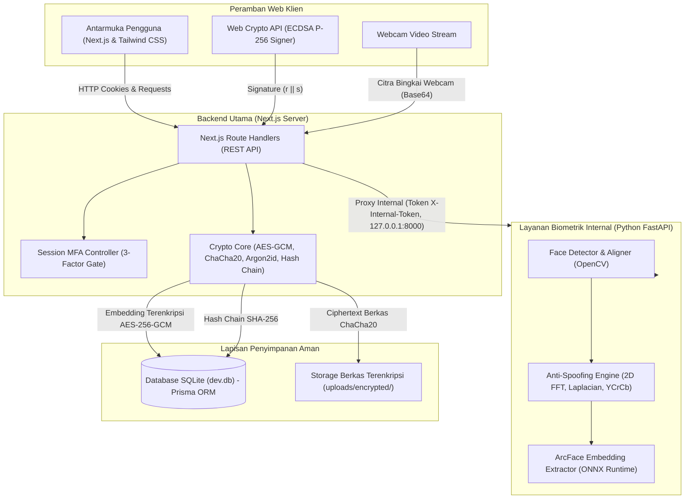
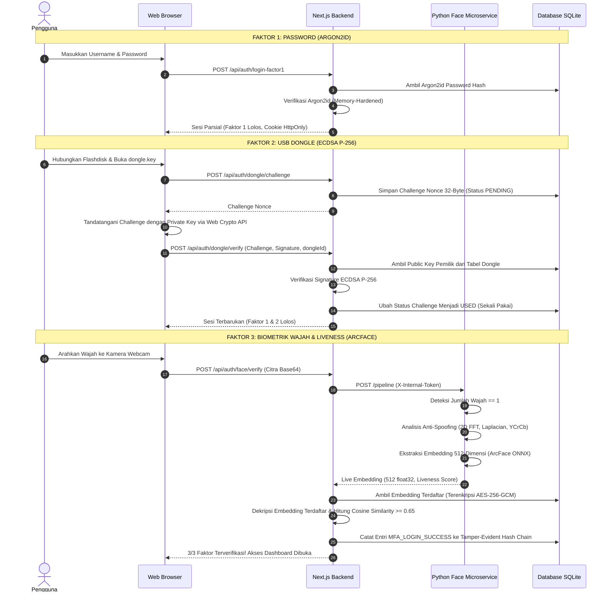
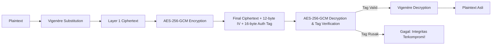
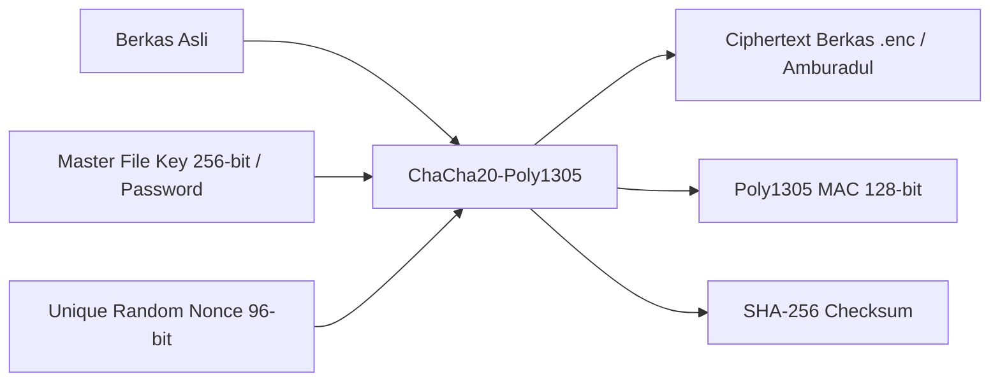

# SecureClass — Platform Akademik Berkeamanan Berlapis

**SecureClass** adalah platform pengelolaan tugas dan dokumen akademik dengan sistem keamanan berlapis (*defense-in-depth*) yang mengintegrasikan autentikasi biometrik wajah berbasis kecerdasan buatan (*Deep Learning ArcFace*), *USB Dongle Challenge-Response* (ECDSA P-256), *Super Encryption* (Vigenère + AES-256-GCM), enkripsi berkas *ChaCha20-Poly1305*, steganografi *Least Significant Bit* (LSB), dan rantai audit *tamper-evident hash chain* (SHA-256).

## Anggota

| NIM | Nama |
| --- | --- |
| 123240239 | Aziz Nabil Putra Darmawan |
| 123240240 | Muhammad Dimas Setiaji |
| 123240254 | Ajrun Ramadhan |

---

## 1. Arsitektur Sistem & Diagram Alur

### A. Diagram Arsitektur Sistem



---

### B. Diagram Alur Autentikasi Tiga Faktor (Zero-Trust 3FA)

Pengguna **tidak dapat mengakses dashboard** sebelum ketiga lapisan verifikasi berhasil divalidasi secara berurutan.



---

### C. Diagram Alur Kriptografi

#### 1. Pesan Teks — Super Encryption (Vigenère + AES-256-GCM)


#### 2. Berkas Akademik — ChaCha20-Poly1305 (RFC 8439)


---

## 2. Rincian Implementasi Kriptografi

| Komponen | Algoritma | Parameter / Standar | Fungsi & Kebijakan Keamanan |
| :--- | :--- | :--- | :--- |
| **Password Hashing** | **Argon2id** | $m=19456\text{ KB}$, $t=2$, $p=1$ | Perlindungan tahan memori (*memory-hard*) terhadap ASIC/GPU cracking dan serangan *side-channel cache-timing*. |
| **USB Dongle Auth** | **ECDSA P-256** | Kurva NIST prime256v1, SHA-256 | Autentikasi *challenge-response*. Kunci privat tidak pernah keluar dari peramban web (*Web Crypto API*). |
| **Pesan Akademik** | **Super Encryption** | Vigenère + AES-256-GCM | Lapisan substitusi polialfabetik klasik diperkuat enkripsi modern dengan otentikasi data terikat (AEAD). Dilengkapi tombol mandiri **ENCRYPT** dan **DECRYPT**. |
| **Enkripsi Berkas** | **ChaCha20-Poly1305** | IETF RFC 8439, 96-bit Nonce, 128-bit Tag | Enkripsi berkas dokumen dipisahkan dari pesan teks. Dilengkapi proteksi password saat buka berkas serta opsi unduh berkas biner amburadul (`.enc`). |
| **Data Biometrik** | **AES-256-GCM** | Kunci master biometrik 256-bit, IV 96-bit | Vektor fitur 512-dimensi disimpan dalam keadaan terenkripsi. Foto mentah (*raw image*) tidak disimpan. |
| **Pesan Database** | **AES-256-GCM** | IV 12-byte acak, Tag 16-byte | Pesan penting/rahasia dienkripsi sebelum persistensi ke SQLite. |
| **Steganografi** | **LSB + AES-256-GCM** | Format PNG, Magic header `SCST`, RGB bit-0 | Pesan dienkripsi AES-256-GCM terlebih dahulu sebelum disisipkan ke LSB kanal warna citra PNG. |
| **Rantai Audit** | **Tamper-Evident Hash Chain** | SHA-256 | Rantai hash kriptografis `SHA256(index + timestamp + prevHash + dataJson)`. Setiap modifikasi ilegal terdeteksi seketika. |

---

## 3. Akun Evaluasi Bawaan & Berkas Demo Dongle

Database telah dilengkapi tiga akun demonstrasi beserta berkas kunci dongle yang telah terpasangkan dan siap disalin ke flashdisk fisik Anda di folder `demo-dongles/`:

| Role | Username | Email | Password | Berkas Kunci Flashdisk Siap Pakai |
| :--- | :--- | :--- | :--- | :--- |
| **Administrator** | `admin` | `admin@secureclass.ac.id` | `AdminPassword123!` | `demo-dongles/admin/dongle.key` |
| **Dosen** | `dosen_budi` | `budi@secureclass.ac.id` | `DosenPassword123!` | `demo-dongles/dosen_budi/dongle.key` |
| **Mahasiswa** | `mhs_ahmad` | `ahmad@secureclass.ac.id` | `MhsPassword123!` | `demo-dongles/mhs_ahmad/dongle.key` |

> **Tips Cepat:** Anda cukup menyalin berkas `dongle.key` dari folder `demo-dongles/mhs_ahmad/` langsung ke root flashdisk USB Anda (misal ke `E:\dongle.key`). Begitu dicolokkan ke port USB, SecureClass akan otomatis mendeteksi flashdisk Anda!

---

## 4. Panduan Menjalankan Aplikasi

### Kebutuhan Sistem
* **Node.js**: v18+ (Direkomendasikan v20+)
* **Python**: v3.10+ (Direkomendasikan v3.11 - v3.13)
* **Webcam**: Kamera aktif pada peramban untuk verifikasi biometrik wajah.

---

### Cara 1: Menjalankan Secara Lokal (Paling Mudah)

Cukup klik dua kali berkas **`start.bat`** di folder utama proyek, atau jalankan perintah berikut lewat dua jendela terminal:

#### Terminal 1 — Layanan Python Face Recognition
```bash
cd face-service
python run.py
```
*Layanan aktif pada `http://127.0.0.1:8000`, diproteksi token rahasia `X-Internal-Token`.*

#### Terminal 2 — Next.js Web Application
```bash
cd web

# 1. Pasang dependensi
npm install

# 2. Sinkronisasi database SQLite & seed akun
npx prisma db push
node prisma/seed.js

# 3. Jalankan server Next.js
npm run dev
```
Buka peramban di: `http://localhost:3000`.

---

### Cara 2: Menjalankan Pengujian Otomatis (Unit & Integration Tests)
```bash
cd web
npm test
```
Seluruh 14 rangkaian pengujian kriptografi dan integrasi database (Argon2id, Vigenère, AES-256-GCM, Super Encryption, ChaCha20-Poly1305, ECDSA P-256, Multi-User Dongle Appending, LSB Steganography, dan Hash Chain Linkage) divalidasi dengan status **100% PASS**.

---

### Cara 3: Menghubungkan Demo Online untuk Dosen (Ngrok / Cloudflare Tunnel)
Jika ingin mendemokan aplikasi ke dosen atau diakses dari HP secara online tanpa kehilangan fitur flashdisk USB fisik:
```bash
ngrok http 3000
```
Ngrok akan memberikan URL publik internet (misal `https://secureclass.ngrok-free.app`) yang terhubung langsung ke laptop Anda lengkap dengan hardware USB dan kamera webcam!

---

### Cara 4: Panduan Deploy ke Vercel
1. Pastikan kode sudah di-push ke GitHub.
2. Di dashboard Vercel, pilih **Import Project**.
3. **PENTING:** Atur **Root Directory** ke folder `web`.
4. Vercel akan otomatis mendeteksi skrip `vercel-build` yang menjalankan `prisma generate` dan inisialisasi basis data SQLite.
5. Konfigurasi Environment Variables di Vercel menggunakan nilai dari `web/.env.example`.

---

## 5. Panduan Fitur Aplikasi

### A. Pendaftaran Akun Baru 3-Factor Auth (`/register`)
1. **Langkah 1 (Kredensial Akun):** Masukkan Username, Email, Nama Lengkap, Role, dan Password yang kuat. Password di-hash menggunakan Argon2id.
2. **Langkah 2 (Pemasangan Dongle):** Colokkan flashdisk USB Anda. Sistem mendeteksi drive USB secara otomatis dan menyematkan pasangan kunci ECDSA P-256 ke dalam berkas `dongle.key`.
3. **Langkah 3 (Perekaman Biometrik Wajah):** Webcam mendeteksi liveness wajah dan mengekstraksi vektor embedding 512 dimensi via ArcFace, yang kemudian dienkripsi menggunakan AES-256-GCM ke database SQLite.

### B. Dukungan Multi-User Dongle (Banyak Pengguna dalam 1 Flashdisk)
* Format berkas `dongle.key` menggunakan arsitektur **Version 2.0 Multi-Key Store**.
* Setiap kali pengguna baru mendaftar atau menulis kunci ke flashdisk yang sama, sistem **tidak menimpa kunci lama**, melainkan menambahkan kunci baru ke dalam daftar `keys`.
* Saat login, sistem otomatis mencocokkan kunci akun yang sedang login.

### C. Penegakan Hardware USB Dongle (FAT32) & Heartbeat Guard
1. **Pemasangan Kunci ke Flashdisk Fisik:**
   * Buka halaman **Pengaturan Keamanan & 3FA** (`/security-settings`).
   * Pilih drive flashdisk Anda (misal `E:\`) lalu klik **"Tulis dongle.key ke Flashdisk"** (atau unduh berkas `dongle.key` dan salin ke root flashdisk).
2. **Penegakan Hardware Lock:**
   * **Saat Login Faktor 2:** Sistem memindai drive komputer mencari flashdisk yang memuat `dongle.key`. Jika flashdisk tidak dicolokkan, login terkunci.
   * **Saat Menggunakan Aplikasi (Hardware Heartbeat Guard):** Jika flashdisk dicabut dari port USB saat Anda sedang di dashboard, layar seketika terkunci penuh: *"⚠️ FLASHDISK USB TERCABUT! Akses dikunci hingga flashdisk dicolokkan kembali"*.

### D. Enrollment & Verifikasi Biometrik Wajah (ArcFace + Liveness)
1. Pada login Faktor 3 (atau halaman pengaturan), berikan izin kamera webcam.
2. Centang persetujuan privasi biometrik (*Privacy Consent*).
3. Posisikan wajah tepat di dalam panduan oval.
4. Sistem memeriksa liveness (anti-spoofing via 2D FFT, Laplacian variance, dan YCrCb chrominance) serta mengekstrak embedding ArcFace 512-dimensi.
5. Embedding dienkripsi dengan AES-256-GCM ke database. Citra foto mentah langsung dimusnahkan dari memori.

### E. Pengiriman Pesan Terenkripsi (Super Encryption: Tombol Kirim & Visualisasi Langkah)
1. Buka menu **Pesan Terenkripsi (Super)** (`/messaging`).
2. Masukkan penerima, ketik pesan asli, dan tentukan kunci Vigenère Anda.
3. **Hanya Satu Tombol Kirim:** Klik tombol **"Kirim Pesan"** untuk mengenkripsi dan mengirim pesan.
4. **Visualisasi Langkah Enkripsi:** Di samping formulir, sistem secara transparan menampilkan hasil matematis dari 3 tahapan enkripsi:
   * **Langkah 1 (Pesan Asli / Plaintext):** Teks asli yang dimasukkan pengguna.
   * **Langkah 2 (Vigenère Cipher):** Hasil substitusi polialfabetik berdasarkan kunci Vigenère.
   * **Langkah 3 (AES-256-GCM):** Ciphertext akhir (Base64) lengkap dengan IV 96-bit dan Auth Tag 128-bit yang disimpan ke database & blockchain.
5. Pada kotak masuk, penerima dapat menekan tombol **"Dekripsi Pesan"** untuk membaca pesan yang diterima.

### F. Enkripsi Berkas Dokumen (ChaCha20-Poly1305: Tanpa Password & Dekripsi Berkas Orang Lain)
1. Buka menu **Enkripsi Berkas (ChaCha20)** (`/file-encryption`).
2. Unggah dokumen apa saja (PDF, DOCX, ZIP, TXT) lalu klik **"Enkripsi Berkas dengan ChaCha20-Poly1305"** (tanpa perlu mengisi password).
3. **Isi Berkas Amburadul:** Klik tombol **"Unduh Berkas Terenkripsi (.enc / Isi Amburadul)"**. Jika berkas ini dibuka di Notepad atau aplikasi teks, isinya 100% berupa karakter acak biner tak terbaca sebagai bukti nyata enkripsi.
4. **Dekripsi Berkas dari Orang Lain:** Pada tab **"Dekripsi Berkas"**, unggah berkas `.enc` yang Anda terima dari orang lain, lalu klik tombol **"Dekripsi Berkas Sekarang"**. Sistem akan otomatis mengembalikan berkas ke bentuk aslinya yang bisa dibaca normal secara instan tanpa perlu memasukkan password.

### G. Steganografi LSB (Penyisipan Pesan ke PNG)
1. Buka menu **Steganografi LSB** (`/steganography`).
2. Masukkan citra pembawa PNG dan pesan rahasia.
3. Pesan dienkripsi dengan AES-256-GCM, lalu bit payload disisipkan ke LSB kanal warna RGB.
4. Unduh citra stego yang dihasilkan.
5. Pada tab **Ekstraksi**, unggah citra stego untuk memulihkan pesan rahasia.

### H. Inspeksi & Simulasi Perusakan Blockchain (Tamper-Evidence)
1. Buka menu **Blockchain (Hash Chain)** (`/blockchain`).
2. Klik **"Validasi Rantai Hash"** untuk memverifikasi seluruh blok audit.
3. Sebagai admin, klik tombol **"Simulasikan Modifikasi Blok #1"** untuk menyuntikkan muatan ilegal.
4. Rantai seketika berubah merah dan menunjukkan titik manipulasi yang terdeteksi secara presisi.
5. Klik **"Pulihkan Rantai"** untuk menghitung ulang hash yang sah.

---

## 6. Keterbatasan Keamanan & Catatan Etika Privasi

1. **USB Flashdisk FAT32:** Flashdisk biasa bukanlah *Hardware Security Module (HSM)* atau *Secure Enclave* bersertifikasi FIPS. Berkas `dongle.key` pada flashdisk secara fisik dapat disalin jika flashdisk dipinjamkan atau dicuri. Oleh sebab itu, SecureClass menerapkan *Defense-in-Depth*: kepemilikan dongle wajib digabungkan dengan pengetahuan Password Argon2id dan keberadaan fisik Biometrik Wajah Liveness.
2. **Tamper-Evident Hash Chain:** Rantai hash dalam satu database SQLite dapat dihitung ulang oleh pengguna dengan hak akses DBA/root. Hash chain menjamin *tamper-evidence* (pendeteksian manipulasi oleh aplikasi), bukan imutabilitas terdesentralisasi tanpa izin.
3. **Privasi Biometrik (Right to be Forgotten):** Pengguna dapat menghapus seluruh profil biometrik wajah terenkripsi mereka kapan saja melalui tombol *Hapus Data Biometrik* pada Pengaturan Keamanan.
